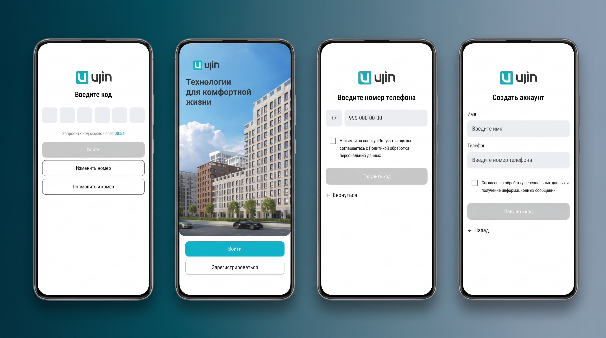
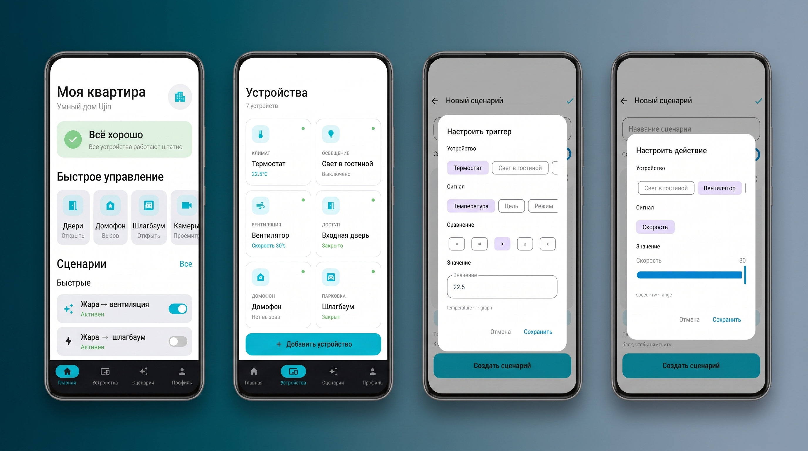
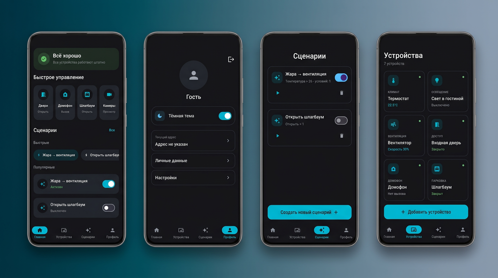

# Ujin Smart Home — Android Client (Hackathon Project)

Мобильное приложение для управления устройствами и сценариями умного дома на базе платформы **Ujin OS**, разработанное в рамках хакатона.

Данный репозиторий представляет собой форк командного проекта [Ujin Smart Home](https://github.com/ElenLen/hackathon-project), сфокусированный на **Android-части** (моя зона ответственности в команде). Проект был модернизирован и адаптирован для независимой демонстрации в портфолио.

---

##  Особенности хакатона и Mock-режим

> **Важно:** Серверный REST API и стенды Ujin OS, предоставленные организаторами на время хакатона, в настоящее время **недоступны**.  
> 
> Чтобы приложение можно было полноценно собрать, запустить и протестировать в любой момент без развертывания локального бэкенда и эмуляторов, мобильный клиент переведен на **Mock-режим** (встроенные статические сценарии и эмуляция откликов устройств).

---

## Основные возможности

- **Мониторинг устройств:** отображение статусов датчиков протечки, термостатов, освещения, шлагбаумов и запорной арматуры.
- **Управление сценариями автоматизации:** запуск правил взаимодействия (например: *Датчик протечки → обнаружена вода → аварийное закрытие арматуры*).
- **Автономная работа:** симуляция работы оборудования без внешних зависимостей.

---

## Скриншоты

###  Авторизация и вход

  

###  Сценарии и устройства

  

###  Тёмная тема

  

---

## Стек технологий (Android)

| Категория | Технологии и компоненты |
| --- | --- |
| **Язык разработки** | Kotlin (Coroutines, StateFlow, SharedFlow) |
| **UI Framework & Дизайн** | Jetpack Compose, Material 3 |
| **Архитектурный подход** | MVVM |
| **Навигация** | Jetpack Navigation Compose |
| **Сетевой слой** | Retrofit 2, OkHttp |
| **Слой данных (Data)** | Переключение между `RemoteSmartHomeRepository` и `MockSmartHomeRepository`|
| **Система сборки** | Gradle (Kotlin DSL) |

---

## Роль в команде хакатона

Оригинальный проект разрабатывался межфункциональной командой:
- **Mobile** — Андрей (Kotlin) 
- **Frontend:** Елена (React, TypeScript, Zustand, React Flow)
- **Backend & Эмуляторы:** Анастасия, Екатерина (FastAPI, Python, SQLite)
- **Дизайн & Аналитика:** Екатерина (Figma)

---

## Сборка и запуск Android-приложения

### Запуск через Android Studio
1. Клонируйте репозиторий
2. Откройте проект в Android Studio.
3. Дождитесь окончания синхронизации Gradle.
4. Выберите эмулятор или подключенное устройство и нажмите **Run ( ▶ )**.

### Сборка через терминал (Gradle Wrapper)
* Собрать Debug APK:
  * Linux/macOS: `./gradlew assembleDebug`
  * Windows: `gradlew.bat assembleDebug`
* Установить на устройство: `./gradlew installDebug`

### Скачать приложение

Вы можете скачать актуальную версию Android-приложения (`.apk`) прямо из репозитория:

---

## Другие работы

[Мобильная разработка](https://02493.github.io/portfolio/)
